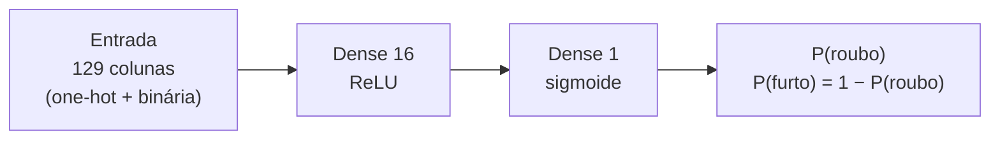

<div align="center">

# 🔎 Roubo ou Furto?
### Classificação de ocorrências em São Paulo com Redes Neurais MLP


-73.6%25-1f4e9c)


**Global Solution · Aprendizado Profundo com Redes Neurais Convolucionais · FIAP**

[🌐 Aplicação web](https://claude.ai/artifact/8WTRgG4cbjwM8Awmh2txn4) · [📓 Notebook](notebooks/mlp_ocorrencias_sp.ipynb) · [📑 Relatório (PDF)](docs/relatorio_tecnico.pdf) · [🧠 Modelo](models/)


</div>

---

> [!WARNING]
> **Este modelo NÃO prevê crimes.** Ele analisa as características de uma ocorrência **já registrada (ou hipotética)** e indica se ela é mais compatível com **roubo** ou **furto**.
> A saída é a probabilidade do *tipo* da ocorrência — **nunca** a chance de um crime acontecer em determinado local ou horário.

## 📚 Sumário
1. [Visão geral](#-visão-geral)
2. [Destaques](#-destaques)
3. [Dados](#-dados)
4. [Pipeline](#-pipeline)
5. [Modelagem](#-modelagem)
6. [Resultados](#-resultados)
7. [Aplicação web](#-aplicação-web)
8. [Relatório técnico em imagens](#-relatório-técnico-em-imagens)
9. [Estrutura do repositório](#-estrutura-do-repositório)
10. [Como reproduzir](#-como-reproduzir)
11. [Decisões técnicas](#-decisões-técnicas)
12. [Limitações e uso responsável](#-limitações-e-uso-responsável)
13. [Equipe, IA generativa e licença](#-equipe)

## 🎯 Visão geral
A segurança pública é um desafio relevante para São Paulo, e os dados públicos de ocorrências permitem demonstrar uma aplicação prática de IA em dados tabulares.
Este projeto constrói, treina, compara e implanta uma **MLP (Multilayer Perceptron)** que recebe cinco características de uma ocorrência — **bairro, tipo de local, dia da semana,
período do dia e se o boletim informa a hora exata** — e devolve as probabilidades de **roubo** e **furto**.

| Entrada | Saída |
|---|---|
| Liberdade · Via pública · sexta-feira · Noite · hora exata informada | **Furto 61,4% · Roubo 38,6%** |

## ✨ Destaques
- 📊 **Base real da SSP-SP** (*Celulares Subtraídos 2026*): 256.076 boletins → 150.990 na capital → amostra de 20.000.
- 🧪 **5 arquiteturas comparadas** (profundidade, largura, ativação e regularização) com seleção feita **na validação** e teste usado **uma única vez**.
- 🛡️ **Sem *data leakage***: a rubrica e os campos que qualificam a natureza do crime ficam fora das entradas; o pré-processador é ajustado só no treino.
- 🔍 **Cuidados com a qualidade dos dados**: recorte pela *cidade dos fatos* (e não pelo município do registro), uma linha por boletim e tratamento da hora ausente sem enviesar a amostra.
- 📏 **Avaliação honesta**: comparação com o *baseline* da classe majoritária, métricas da classe minoritária e **ablação** do atributo mais influente.
- 🌐 **Aplicação web** funcional, em duas versões: Flask (servidor) e página autônoma (a MLP roda no navegador).

## 📊 Dados
| Item | Detalhe |
|---|---|
| **Fonte** | SSP-SP · Portal de Estatísticas · Bases de Dados — <https://www.ssp.sp.gov.br/estatistica/consultas> |
| **Base** | *Celulares Subtraídos 2026* (`CelularesSubtraidos_2026.xlsx`, aba `CELULAR_2026`, 55 colunas) |
| **Recorte geográfico** | `CIDADE == S.PAULO` — a **cidade dos fatos**. (`NOME_MUNICIPIO` é o município responsável pelo *registro* e não serve para este recorte.) |
| **Rótulo** | `RUBRICA`: **Roubo** (art. 157) → 1 · **Furto** (art. 155/156) → 0. Outras naturezas e boletins ambíguos são descartados. |
| **Duplicidades** | Boletim com vários itens vira **1 linha** (chave `NUM_BO + ANO_BO + ID_DELEGACIA`). 14.291 linhas removidas. |
| **Amostra** | 20.000 registros aleatórios (semente 42) · 34,8% roubo |
| **Divisão** | 70% treino (14.000) · 15% validação (3.000) · 15% teste (3.000), estratificada pela classe |

### Atributos de entrada
| Atributo | Tipo | Por que usar | Tratamento |
|---|---|---|---|
| `bairro` | categórico (~1.900 grafias) | contexto geográfico do fato | one-hot; bairros com < 30 casos no **treino** → categoria “infrequente” |
| `tipo_local` | categórico | via pública, terminal, residência… mudam a natureza do crime | one-hot |
| `dia_semana` | categórico | rotina semanal, derivado da data do fato | one-hot |
| `periodo` | categórico | madrugada · manhã · tarde · noite | one-hot |
| `hora_informada` | binário (0/1) | o BO traz a hora exata ou só o período | passa direto (já em 0/1) |

**Excluídos de propósito:** `RUBRICA` e campos que qualificam a natureza (`DESCR_CONDUTA`, `DESDOBRAMENTO`, `CIRCUNSTANCIA`) — vazariam o rótulo; dados pessoais, logradouro e latitude/longitude — quase identificadores.

> **Hora ausente (41,1% dos BOs).** Nesses casos a base informa o período em `DESCR_PERIODO`. Descartar essas linhas removeria dezenas de milhares de registros e **enviesaria a amostra**:
> só ~20% dos BOs sem hora exata são roubo, contra ~51% nos que têm hora. Por isso o período vem da hora **ou** de `DESCR_PERIODO`, e criamos o atributo `hora_informada`.

### Exploração dos dados
<p align="center"></p>

- **Classes desbalanceadas:** furto é a maioria — por isso a acurácia é comparada com o *baseline* e usamos precision/recall/F1 da classe *roubo*.
- **O tipo de local e o período carregam sinal:** a proporção de roubo varia bastante entre tipos de local e é maior na madrugada e à noite.
- **Boletins sem hora exata** têm proporção de roubo bem menor, o que justifica o atributo `hora_informada` e o cuidado de não descartar essas linhas.

> Os dados brutos **não** estão neste repositório (72 MB, propriedade da SSP-SP). Veja [Como reproduzir](#-como-reproduzir).

## 🔄 Pipeline

```mermaid
flowchart LR
    A["SSP-SP<br/>Celulares Subtraídos 2026"] --> B["Recorte<br/>CIDADE = S.PAULO"]
    B --> C["Rótulo pela rubrica<br/>roubo = 1 · furto = 0"]
    C --> D["Uma linha<br/>por boletim"]
    D --> E["Atributos<br/>+ amostra 20 mil"]
    E --> F["Split estratificado<br/>70 / 15 / 15"]
    F --> G["One-hot<br/>(fit só no treino)"]
    G --> H["Treino de 5 MLPs<br/>early stopping"]
    H --> I["Seleção na<br/>validação"]
    I --> J["Teste final<br/>(uma vez)"]
    J --> K["App web<br/>Flask / navegador"]
```


## 🧠 Modelagem
### Arquitetura do modelo selecionado

- **Camadas ocultas densas:** cada neurônio calcula `a = ReLU(W·x + b)`, combinando atributos de forma não linear (ex.: *via pública* **e** *noite*).
- **Saída:** 1 neurônio com **sigmoide** → P(roubo) ∈ (0, 1); classe *roubo* se P ≥ 0,5.
- **Perda:** entropia cruzada binária (log-loss) · **Otimizador:** Adam (lr = 1e-3) · **Batch:** 128.
- **Regularização:** penalidade L2 (`alpha`) + ***early stopping*** na perda de validação (paciência 8; restaura os melhores pesos).
- **Implementação:** `sklearn.neural_network.MLPClassifier` treinado **uma época por vez** (`partial_fit`) para registrar as curvas de treino e validação.

### Arquiteturas comparadas
| Config. | Camadas ocultas | Ativação | L2 (alpha) |
|---|---|---|---:|
| A | 16 | relu | 0.0001 |
| B | 64-32 | relu | 0.0001 |
| C | 128-64-32 | relu | 1e-05 |
| D | 128-64-32 | relu | 0.1 |
| E | 64-32 | tanh | 0.0001 |

> **C** testa alta capacidade com pouca regularização · **D** é a mesma rede de C com L2 forte (efeito da regularização) · **E** é a mesma rede de B com `tanh` (efeito da ativação).

**Critério de seleção:** maior F1 (classe *roubo*) na **validação**; diferenças de até 0,5 p.p. são tratadas como empate técnico e vence o modelo com **menos parâmetros** (parcimônia).

## 📈 Resultados
### Validação — comparação das arquiteturas
*(classe positiva = roubo)*

| Modelo | Pesos | Melhor época / treinadas | Acurácia | Precision | Recall | F1 | |
|---|---:|:---:|---:|---:|---:|---:|:---:|
| **A_simples (16)** | 2.080 | 20/28 | 73,8% | 64,3% | 55,7% | **59,7%** | ✅ |
| B_media (64-32) | 10.336 | 5/13 | 73,4% | 67,9% | 44,4% | **53,7%** |  |
| C_profunda (128-64-32) | 26.784 | 1/9 | 73,1% | 68,0% | 42,8% | **52,6%** |  |
| D_profunda_L2 (128-64-32) | 26.784 | 7/15 | 73,5% | 73,0% | 37,7% | **49,7%** |  |
| E_tanh (64-32) | 10.336 | 17/25 | 73,4% | 68,5% | 43,7% | **53,3%** |  |

<p align="center"></p>

### Teste final — modelo selecionado (`A_simples (16)`)
| Acurácia | Precision | Recall | F1 | Baseline “sempre furto” |
|:---:|:---:|:---:|:---:|:---:|
| **73,6%** | 64,5% | 53,9% | **58,7%** | 65,2% |

A MLP supera o baseline em **8,4 p.p.** de acurácia.

<p align="center">
  
  
</p>

| Matriz de confusão (teste) | Previsto: furto | Previsto: roubo |
|---|:---:|:---:|
| **Real: furto** | 1646 | 310 |
| **Real: roubo** | 481 | 563 |

### O que os resultados mostram
- **Sem overfitting relevante:** as curvas de treino e validação ficam próximas; o *early stopping* escolhe a melhor época.
- **Mais capacidade não ajudou:** as redes maiores (C, D) não superaram a de 16 neurônios — o limite está na **informação dos atributos**, não no tamanho da rede.
- **Roubo é a classe minoritária** (34,8%): o modelo é conservador ao apontar roubo (*precision* > *recall*). Com limiar 0,5, o recall é de 53,9%; o limiar pode ser ajustado conforme o custo de cada tipo de erro.
- **Ablação — `hora_informada`:** sem esse atributo, o F1 de validação cai de **59,7%** para **52,0%**. Ele reflete *como o boletim foi registrado* (furtos costumam ser percebidos depois, sem hora exata) e deve ser interpretado com essa ressalva.

## 🌐 Aplicação web
O formulário usa **exatamente** os atributos do treino e mostra a classe estimada e as probabilidades de roubo e furto, com o aviso de interpretação sempre visível.

| Versão | Como acessar | Observação |
|---|---|---|
| **Página autônoma** | **https://claude.ai/artifact/8WTRgG4cbjwM8Awmh2txn4** | A MLP roda **no navegador** (pesos embutidos em `app/app_estatica.html`). Validada contra o scikit-learn: diferença máxima de **2e-16**. |
| **Flask** | `python app/app.py` → <http://127.0.0.1:5000> | Servidor com API JSON; pronto para deploy (`render.yaml`, `Procfile`). |

<p align="center">
  
  &nbsp;&nbsp;
  
</p>
<p align="center"><sub>Dois exemplos na interface: ocorrência mais compatível com <b>furto</b> (esquerda) e com <b>roubo</b> (direita). As probabilidades descrevem o <i>tipo</i> da ocorrência, não o risco de um crime.</sub></p>

### API (Flask)
| Método | Rota | Descrição |
|---|---|---|
| `GET` | `/` | Formulário web |
| `POST` | `/api/predict` | Classifica uma ocorrência |
| `GET` | `/health` | Status e nome do modelo |

```bash
curl -X POST http://127.0.0.1:5000/api/predict -H "Content-Type: application/json" \
  -d '{"bairro":"LIBERDADE","tipo_local":"VIA PUBLICA","dia_semana":"sexta-feira","periodo":"Noite","hora_informada":1}'
```
```json
{ "classe": "furto", "prob_furto": 0.6139, "prob_roubo": 0.3861 }
```
Valores fora da lista (bairros raros, por exemplo) são mapeados para a categoria “infrequente” aprendida no treino. Entradas inválidas retornam `400` com a mensagem de erro.

## 📸 Relatório técnico em imagens
Versão completa em [`docs/relatorio_tecnico.pdf`](docs/relatorio_tecnico.pdf) (10 slides). Clique em uma miniatura para ampliar.

<details>
<summary><b>Ver os 10 slides</b></summary>

<table>
<tr><td align="center"><a href="docs/img/slide-01.png"></a><br><sub>1. Capa</sub></td><td align="center"><a href="docs/img/slide-02.png"></a><br><sub>2. Problema, fonte e recorte</sub></td></tr>
<tr><td align="center"><a href="docs/img/slide-03.png"></a><br><sub>3. Preparação dos dados</sub></td><td align="center"><a href="docs/img/slide-04.png"></a><br><sub>4. Arquitetura da MLP</sub></td></tr>
<tr><td align="center"><a href="docs/img/slide-05.png"></a><br><sub>5. Configuração do treinamento</sub></td><td align="center"><a href="docs/img/slide-06.png"></a><br><sub>6. Arquiteturas testadas</sub></td></tr>
<tr><td align="center"><a href="docs/img/slide-07.png"></a><br><sub>7. Comparação e escolha</sub></td><td align="center"><a href="docs/img/slide-08.png"></a><br><sub>8. Curvas e matriz de confusão</sub></td></tr>
<tr><td align="center"><a href="docs/img/slide-09.png"></a><br><sub>9. Aplicação web</sub></td><td align="center"><a href="docs/img/slide-10.png"></a><br><sub>10. Conclusões</sub></td></tr>
</table>

</details>

## 📁 Estrutura do repositório
```text
.
├── README.md
├── LICENSE
├── requirements.txt · Procfile · render.yaml
├── notebooks/
│   └── mlp_ocorrencias_sp.ipynb      # análise completa, já executada (GitHub renderiza)
├── docs/
│   ├── relatorio_tecnico.pdf|pptx    # relatório técnico de 10 slides
│   └── img/                          # slides em PNG (usados no README)
├── src/
│   ├── data_prep.py                  # leitura, recorte, rótulo, duplicidades, atributos
│   ├── mlp_lib.py                    # pré-processamento, treino, métricas, gráficos, seleção
│   ├── train.py                      # pipeline completo (linha de comando)
│   └── synthetic_data.py             # dados sintéticos só para testar o pipeline (--demo)
├── app/
│   ├── app.py · templates/index.html # aplicação Flask
│   └── app_estatica.html             # versão autônoma (MLP em JavaScript)
├── models/                           # modelo_mlp.joblib · metrics.json
├── reports/figs/                     # gráficos e print da interface
├── tools/                            # xlsx→csv · gerar notebook, relatório e app estático
└── data/raw/                         # (vazio) coloque aqui o CSV da SSP-SP
```

## 🔁 Como reproduzir
**Requisitos:** Python 3.10+ e Git.

```bash
# 1. clonar e instalar
git clone <URL_DO_REPOSITORIO> && cd <PASTA>
python -m venv .venv
source .venv/bin/activate            # Windows (Git Bash): source .venv/Scripts/activate
pip install -r requirements.txt

# 2. obter os dados: baixe CelularesSubtraidos_2026.xlsx em
#    https://www.ssp.sp.gov.br/estatistica/consultas  (Bases de Dados) e converta:
python tools/xlsx_to_csv.py CelularesSubtraidos_2026.xlsx data/raw/CelularesSubtraidos_2026.csv

# 3. treinar, avaliar e salvar o modelo (gera models/ e reports/figs/)
python -m src.train --data data/raw/CelularesSubtraidos_2026.csv

# 4. (opcional) regenerar notebook, relatório e app estático
python tools/build_notebook.py
python tools/build_report.py
python tools/build_static_app.py

# 5. rodar a aplicação
python app/app.py                    # http://127.0.0.1:5000
```
> **Sem os dados?** `python -m src.train --demo` executa o pipeline com **dados sintéticos** — serve apenas como teste técnico (a interface exibe um aviso e os resultados não têm valor real).
>
> O `.xlsx` tem ~72 MB; `pandas.read_excel` é lento nele, por isso o conversor em *streaming* (`tools/xlsx_to_csv.py`).

### Deploy do Flask (Render)
*New → Web Service* → conecte o repositório → o `render.yaml` configura tudo (`gunicorn app.app:app`). Mantenha `models/modelo_mlp.joblib` versionado. Teste com `GET /health`.

## 🧭 Decisões técnicas
| Decisão | Motivo |
|---|---|
| Usar `CIDADE` e não `NOME_MUNICIPIO` | O dicionário da SSP define `CIDADE` como cidade dos fatos; `NOME_MUNICIPIO` é onde o BO foi registrado. |
| Período via `DESCR_PERIODO` + flag `hora_informada` | Evita descartar ~41% dos BOs e o viés de seleção que isso causaria. |
| Agrupar bairros raros **no treino** (`min_frequency=30`) | ~1.900 grafias distintas; fazer isso só com o treino evita vazamento. |
| Sem escalonamento | Todas as entradas já são one-hot/binárias (0/1); não há variável contínua. |
| Early stopping + L2 | Controlam overfitting sem dropout (não disponível no `MLPClassifier`). |
| Seleção por F1 com parcimônia | Diferenças < 0,5 p.p. estão dentro do ruído entre execuções. |
| Métricas da classe *roubo* + baseline | Com classes desbalanceadas, a acurácia sozinha engana. |
| Semente fixa (42) | Resultados reproduzíveis. |

## 🚧 Limitações e uso responsável
- **Subnotificação e vieses:** os boletins refletem apenas o que foi registrado, e a rubrica depende da classificação policial. Pode haver vieses geográficos e sociais.
- **Escopo temporal:** apenas ocorrências com boletim registrado em 2026; não foi feita validação temporal.
- **Informação limitada:** local, bairro, dia e período explicam parte da natureza do crime; o desempenho é moderado e não deve ser tratado como determinístico.
- **`hora_informada`** é um artefato do registro do boletim (ver ablação).
- **Uso indevido:** o modelo **não** deve ser usado para policiamento preditivo, para estimar risco de locais ou para julgar pessoas.
- **Próximos passos:** mais anos de dados, validação temporal, calibração de probabilidades, ajuste do limiar de decisão e outras fontes de atributos.

## 👥 Equipe
| Nome | RM |
|---|---|
| Gabriel Lima da Silva | 568436 |
| Nicolas Araujo de Oliveira | 566780 |

## 🤖 Uso de IA generativa
Um assistente de IA (Claude) apoiou a estruturação do código, a depuração e a documentação. A equipe revisou, executou e consegue explicar o código, o processo de treinamento, o funcionamento das camadas da MLP e os critérios de escolha da arquitetura.

## 📄 Licença e créditos
Código sob licença [MIT](LICENSE). Os dados pertencem à **Secretaria da Segurança Pública do Estado de São Paulo (SSP-SP)** e **não** são redistribuídos neste repositório.
