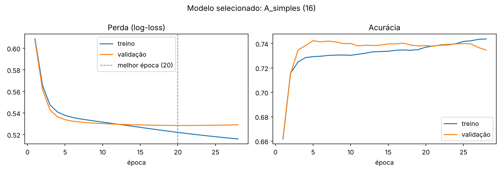
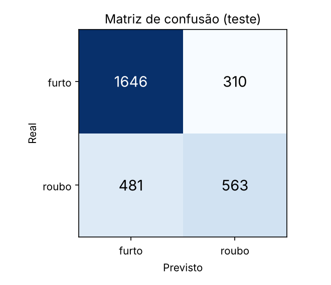

# 🔎 Roubo ou furto? MLP para classificar ocorrências em São Paulo

**Global Solution — Aprendizado Profundo com Redes Neurais Convolucionais (FIAP)**  
**Equipe:** Gabriel Lima da Silva (RM 568436) · Nicolas Araujo de Oliveira (RM 566780)

Uma **MLP** recebe as características de uma ocorrência **já registrada (ou hipotética)** na capital paulista — bairro, tipo de local,
dia da semana, período e se o boletim traz a hora exata — e devolve a **probabilidade de ser roubo ou furto**.

> ⚠️ **O modelo não prevê crimes** nem estima o risco de um crime acontecer em um local/horário. Ele classifica o *tipo* de uma ocorrência.

## 🚀 Acesso rápido
| Entrega | Onde |
|---|---|
| 🌐 **Aplicação web** (roda no navegador) | **https://claude.ai/artifact/8WTRgG4cbjwM8Awmh2txn4** |
| 📓 Notebook documentado (com saídas) | [`notebooks/mlp_ocorrencias_sp.ipynb`](notebooks/mlp_ocorrencias_sp.ipynb) |
| 📑 Relatório técnico (10 slides) | [`docs/relatorio_tecnico.pdf`](docs/relatorio_tecnico.pdf) · [`.pptx`](docs/relatorio_tecnico.pptx) |
| 🧠 Modelo treinado e métricas | [`models/`](models/) |

<p align="center"></p>

## 📊 Dados
* **Fonte:** SSP-SP, Portal de Estatísticas → Bases de Dados: <https://www.ssp.sp.gov.br/estatistica/consultas>
* **Base:** *Celulares Subtraídos 2026* (`CelularesSubtraidos_2026.xlsx`, aba `CELULAR_2026`, 256.076 linhas).
* **Recorte:** `CIDADE == S.PAULO` (cidade **dos fatos**; `NOME_MUNICIPIO` é o município do *registro*) → 150.990 linhas.
* **Rótulo:** `RUBRICA` — Roubo (art. 157) = 1; Furto (art. 155/156) = 0. Outras naturezas descartadas. Uma linha por boletim (`NUM_BO + ANO_BO + ID_DELEGACIA`).
* **Amostra:** 20.000 registros aleatórios (34.8% roubo), divididos 70/15/15 (treino/validação/teste), estratificados.
* **Atributos:** `bairro`, `tipo_local`, `dia_semana`, `periodo`, `hora_informada` (0/1). A rubrica e campos que qualificam a natureza do crime **não** entram (sem *data leakage*).
* **Hora ausente (~41.1% dos BOs):** o período vem de `DESCR_PERIODO`; descartar essas linhas enviesaria a amostra (só ~20% delas são roubo, contra ~51% nas com hora).

> Os dados brutos **não** estão no repositório (72 MB). Veja [Como reproduzir](#-como-reproduzir).

## 🧠 Modelagem
`Entrada (129 colunas one-hot/binárias) → Dense(n, ReLU) × k → Dense(1, sigmoide)` · perda log-loss · Adam (lr 1e-3) · batch 128 · regularização L2 · *early stopping* na perda de validação (restaura os melhores pesos).

Cinco arquiteturas comparadas (profundidade, largura, ativação e regularização). Seleção **na validação** (maior F1; empate técnico ≤ 0,5 p.p. → menos parâmetros). Teste usado **uma única vez**.

| Modelo | Pesos | Acurácia | Precision | Recall | F1 |
|---|---:|---:|---:|---:|---:|
| **A_simples (16)** ✅ | 2.080 | 73.8% | 64.3% | 55.7% | 59.7% |
| B_media (64-32) | 10.336 | 73.4% | 67.9% | 44.4% | 53.7% |
| C_profunda (128-64-32) | 26.784 | 73.1% | 68.0% | 42.8% | 52.6% |
| D_profunda_L2 (128-64-32) | 26.784 | 73.5% | 73.0% | 37.7% | 49.7% |
| E_tanh (64-32) | 10.336 | 73.4% | 68.5% | 43.7% | 53.3% |

*(métricas de validação; classe positiva = roubo)*

### Resultado final (teste)
| Acurácia | Precision | Recall | F1 | Baseline “sempre furto” |
|---:|---:|---:|---:|---:|
| **73.6%** | 64.5% | 53.9% | 58.7% | 65.2% |

<p align="center"> </p>

**Leitura:** a MLP supera o baseline, mas redes maiores não ajudaram — o limite está na informação dos atributos. Sem `hora_informada`, o F1 de validação
cai de 59.7% para 52.0% (o atributo reflete *como o BO foi registrado*). Roubo é a classe minoritária, por isso o recall é modesto.

## 🗂️ Estrutura
```
├── README.md
├── notebooks/mlp_ocorrencias_sp.ipynb   # análise completa, executada
├── docs/relatorio_tecnico.pdf|pptx      # relatório de 10 slides
├── src/
│   ├── data_prep.py                     # leitura, recorte, rótulo, duplicidades, atributos
│   ├── mlp_lib.py                       # pré-processamento, treino, métricas, gráficos, seleção
│   ├── train.py                         # pipeline completo (CLI)
│   └── synthetic_data.py                # dados sintéticos só para testar o pipeline (--demo)
├── app/
│   ├── app.py + templates/              # aplicação web Flask
│   └── app_estatica.html                # versão autônoma (MLP em JavaScript) publicada no link acima
├── models/                              # modelo_mlp.joblib + metrics.json
├── reports/figs/                        # figuras
├── tools/                               # xlsx→csv, gerar notebook/relatório/app estático
├── data/raw/                            # (vazio) coloque aqui o CSV da SSP-SP
├── requirements.txt · Procfile · render.yaml
```

## 🔁 Como reproduzir
```bash
git clone <URL_DO_REPOSITORIO> && cd <PASTA>
python -m venv .venv && source .venv/bin/activate        # Windows: .venv\Scripts\activate
pip install -r requirements.txt

# 1) baixe CelularesSubtraidos_2026.xlsx em https://www.ssp.sp.gov.br/estatistica/consultas e converta:
python tools/xlsx_to_csv.py CelularesSubtraidos_2026.xlsx data/raw/CelularesSubtraidos_2026.csv

# 2) treine, avalie e salve o modelo
python -m src.train --data data/raw/CelularesSubtraidos_2026.csv

# 3) (opcional) regenere notebook, relatório e app estático
python tools/build_notebook.py && python tools/build_report.py && python tools/build_static_app.py

# 4) aplicação web Flask local
python app/app.py        # http://127.0.0.1:5000
```
Sem os dados? `python -m src.train --demo` roda o pipeline com **dados sintéticos** (apenas teste técnico; a interface exibe um aviso).

**Deploy do Flask:** o `render.yaml` configura o [Render](https://render.com) (`gunicorn app.app:app`). Teste com `GET /health`.

## ⚖️ Uso responsável e limitações
Os boletins refletem apenas o que foi registrado (subnotificação) e a classificação policial da rubrica; há possíveis vieses geográficos e só ocorrências de 2026.
O modelo **não** deve ser usado para policiamento preditivo nem para julgar pessoas ou locais.

## 🤖 Uso de IA generativa
Assistente de IA (Claude) apoiou a estrutura do código, a depuração e a documentação. A equipe revisou, executou e consegue explicar cada etapa.

## 📄 Licença
[MIT](LICENSE) — os dados pertencem à SSP-SP e não são redistribuídos aqui.
